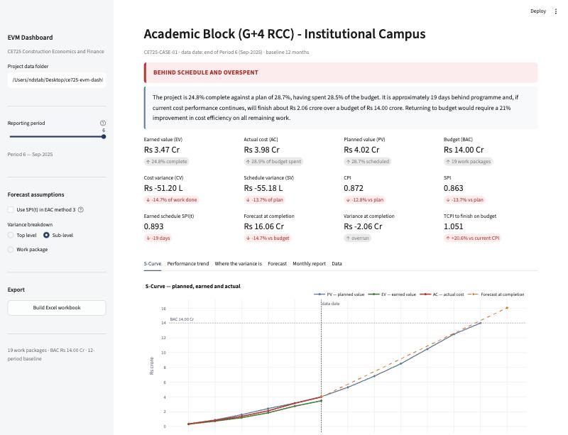
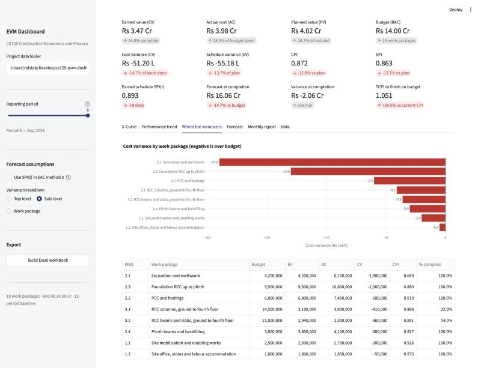

# User Manual

**CE725 Earned Value Management Dashboard**
Version 1.0 · For project managers, planning engineers and cost consultants

**Live tool:** <https://ce725-evm-dashboard-3hfqkptabnvbzvzyb8uopr.streamlit.app>

---

## 1. What this tool does

It takes a project's budget, its baseline programme and its reported
monthly progress and cost, and answers three questions:

1. **Where the project stands** — over budget, behind programme, or both,
   and by how much in rupees and in days.
2. **Where the problem is** — which work packages drive the variance, and
   whether that variance is still recoverable.
3. **Where it will end up** — forecast cost under four assumptions, and
   whether the original budget is still reachable.

It is a reporting and diagnostic tool. It does not plan, schedule or price
work.



## 2. Starting the tool

Open the live link above — it needs nothing installed and ships with a
worked case study, so it is usable immediately, and you can load your own
project into it from the sidebar (section 3). To run it locally instead
(Python 3.11+):

```bash
git clone https://github.com/ndstab/ce725-evm-dashboard.git
cd ce725-evm-dashboard && python -m venv .venv
.venv/bin/pip install -r requirements.txt
.venv/bin/streamlit run app/streamlit_app.py
```

## 3. Required inputs

The tool runs on any project supplied as three CSVs and one JSON. In the
sidebar, **Download data template** gives you the worked case study in
exactly the format expected — edit those four files and load them back
through **Upload your own**. A working example is easier to edit correctly
than a blank form is to fill in, because the baseline has to reconcile to
each package budget and the packages to BAC, which is easier to preserve
than to achieve.

**`wbs.csv` — the work breakdown structure.** Columns: `wbs_id`
(dotted for hierarchy: `2`, `2.1`), `parent_id` (blank at top level),
`name`, `is_leaf` (`Y` carries budget, `N` is a summary branch),
`budget_inr` (leaves only). Only leaves carry budget; a branch is the sum
of its leaves. Budget a branch *and* its children and you have
double-counted — the tool rejects the file.

**`baseline.csv` — the time-phased budget.** Columns: `wbs_id`, `period`
(1 upward), `pv_period_inr`. This is the money you planned to earn, period
by period. Per package it must sum to that package's budget, and overall
to BAC.

**`actuals.csv` — what happened.** Columns: `wbs_id`, `period`,
`pct_complete_cum`, `ac_period_inr`. Note the asymmetry, which is the
commonest source of error: progress is **cumulative and a fraction**
(`0.45`, not `45`), cost is **per period**. That is how each is normally
reported — site measures progress to date, accounts book a month's cost —
so each is taken in its natural form.

**`project.json` — constants.** `project_name`, `project_code`,
`currency`, `baseline_periods`, `period_unit`, `data_date_period`,
`period_labels`, `bac_inr`. `data_date_period` is the last period with
reported actuals; nothing after it may appear in `actuals.csv`.

Input is validated strictly, and bad data is **refused rather than
computed from**. EVM output is three ratios near 1.00 with no sanity check
a reader can apply: a CPI of 0.94 from corrupt data looks exactly like a
CPI of 0.94 from good data, and it will be taken to a client meeting. Each
rejection message names the file, the row and the fix.

## 4. Reading the dashboard

**The verdict and summary.** The coloured bar is a traffic light. The
paragraph under it is written for someone who will not read the rest, and
quotes no index without the consequence in rupees or days beside it. It is
produced from templates, not a language model: the same inputs give the
same sentence every month, and every threshold behind a phrase like
"behind plan" is written in `evm/commentary.py` where you can disagree
with it.

**The index tiles.** CPI is rupees of budgeted work returned per rupee
spent — 0.872 means ₹1 buys 87 paise of budgeted work. SPI is the same
question for schedule, measured in money; SPI(t) measures it in time. EAC
forecasts total cost, VAC the overrun (negative is bad), and TCPI the
efficiency the *remaining* work must achieve to finish on budget.

**The most useful single comparison is TCPI against CPI.** On the case
study the project has sustained CPI 0.872 for six months while TCPI
demands 1.051 — a 20.6% improvement on performance never once achieved.
The budget is gone; what remains is deciding who absorbs it.



**Where the variance is.** Bars run left for over budget. Percent complete
is the column that decides what you can do: a package at **100%** has a
variance that is **final**, and no recovery plan touches it; a package
part complete can still move. On the case study ₹38 lakh of the ₹51.20
lakh adverse variance sits in three finished substructure packages. Only
₹7.7 lakh, in the frame, is still live.

**Performance trend.** Watch two things. *CPI flatness* — CPI stabilises
early, often by 20% complete, and rarely recovers; here it holds between
0.86 and 0.88 for all six periods while SPI swings from 0.88 to 0.74 and
back. A flat, below-1.00 CPI is the strongest argument against an
optimistic recovery plan. *The SPI / SPI(t) gap* — at completion EV must
equal PV, so **classical SPI returns to 1.00 on every project however late
it finishes**, growing more reassuring as the project gets later. SPI(t)
is measured in time and has no such defect. Late in a project, trust
SPI(t).

**Forecast.** Four EAC methods, shown together on purpose. They differ in
one assumption — what you believe about the remaining work. **EAC1**
(BAC/CPI) assumes nothing has changed, and is hard to beat once CPI has
settled. **EAC2** assumes the overrun had an identified, now-closed cause.
**EAC3** and **EAC4** assume schedule pressure continues, and acceleration
costs money. A single EAC implies a precision the method does not have.
Quote the range.

**Monthly report.** A generated narrative for pasting into a progress
report, downloadable as text.

## 5. Exporting to Excel

**Build Excel workbook**, then **Download workbook**. Every figure is a
**live formula**, not a pasted value: change a budget or a percent
complete on the yellow Inputs sheet and the indices, forecasts, verdict
and charts all recalculate. Hand it to a quantity surveyor who has never
seen this tool and they can work with it. Sheets: Dashboard, Inputs,
Baseline, EVM, Variance.

## 6. Key assumptions

1. **Percent complete is accurate** — see section 7.
2. **Planned value accrues linearly within a period**, used when
   interpolating Earned Schedule. Mild over a month; unsafe over a quarter.
3. **One baseline.** Re-baselining is not modelled.
4. **Work continues.** Forecasts extrapolate performance; a suspended
   project needs a re-baseline, not an extrapolation.
5. **Nominal rupees at one price base.** No escalation, no multi-currency.
6. **Costs are booked to the right package in the right period.** The tool
   cannot detect miscoding.

## 7. Known limitations

**The one that matters most.** Earned value is percent complete multiplied
by budget, and percent complete is a judgement made at site, often by
someone with an interest in the answer. **If a package is reported at 60%
when it is really 40%, every index here is confidently, precisely wrong,
and nothing in the software can detect it.** The arithmetic has been
validated to nine decimal places against an independent benchmark (see
`docs/04-validation-report.md`). That validates the *calculation* and says
nothing about the *measurement*. Deploy a tool like this and the
governance around how percent complete is assessed, and by whom, matters
more than the software — and it is the part most likely to be neglected,
because it is the part you cannot buy.

**Others, in order of how likely they are to bite:**

- **No critical path.** The tool reads a time-phased budget, not a
  network. It can say the project is 19 days behind in aggregate; it
  cannot say whether the slipped package is critical, so it cannot say
  whether the completion date has moved.
- **No re-baselining.** One baseline per project.
- **Equal-length periods assumed.** Mixing a two-week period with a
  five-week one distorts the trend charts.
- **No retention, advance or cash flow.** A project can be green on every
  index here and still run out of money.
- **Variations assumed already in the budget.** If scope was added and the
  budget not revised, packages report above 100% complete and the file is
  rejected rather than guessed at.
- **Not tested against messy real data.** The case study is synthetic.
  Missing periods, retrospective corrections and miscoded costs are
  handled in principle, not against a real ledger.

**Do not take the arithmetic on trust.** `pytest tests/` runs 150 tests
whose expected values were hand-derived from the case study before the
engine existed; `python scripts/validate_benchmark.py` re-runs the full
comparison against the independent Excel benchmark (needs LibreOffice).
