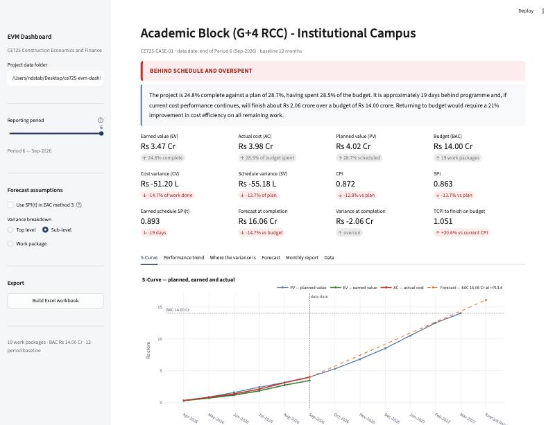
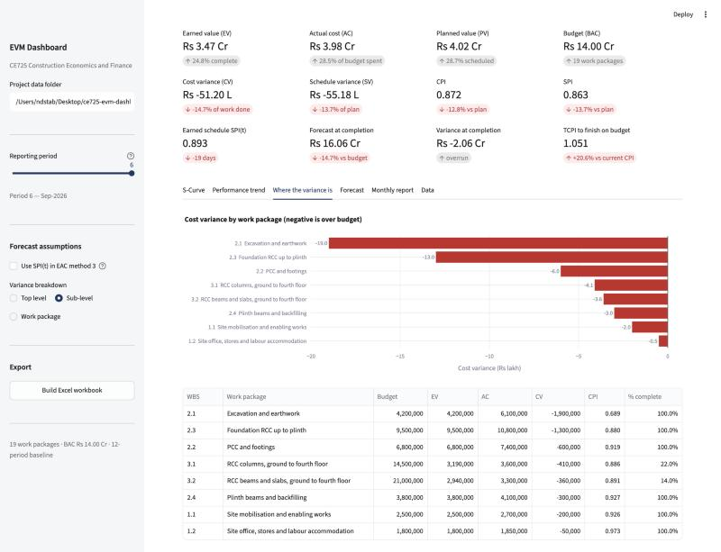
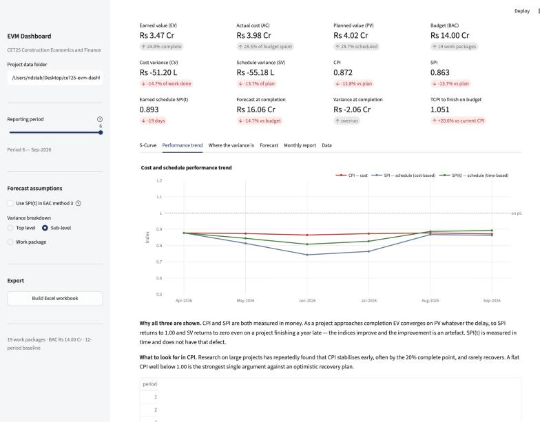
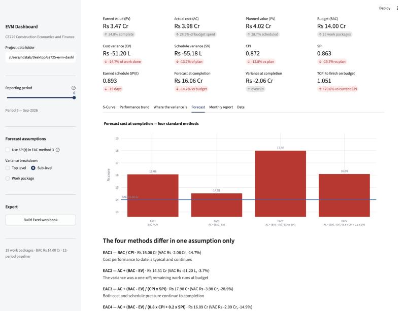
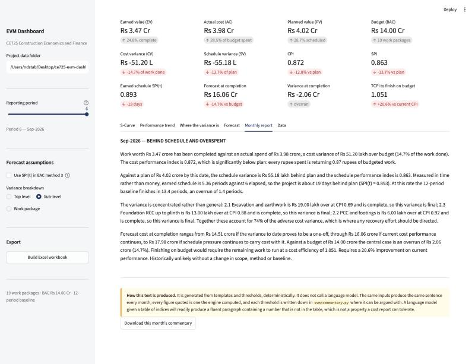

# User Manual

**CE725 Earned Value Management Dashboard**
Version 1.0 · For project managers, planning engineers and cost consultants

---

## 1. What this tool does

It takes a construction project's budget, its baseline programme and its
reported monthly progress and cost, and tells you three things:

1. **Where the project stands** — is it over budget, behind programme, or
   both, and by how much in rupees and in days.
2. **Where the problem is** — which work packages are driving the
   variance, and whether their variance is still recoverable.
3. **Where it will end up** — what the project is now forecast to cost,
   under four different assumptions, and whether the original budget is
   still reachable.

It is a reporting and diagnostic tool. It does not plan, schedule or
price work.



---

## 2. Installation and starting the tool

**Requirements:** Python 3.11 or later. LibreOffice is optional and only
needed to regenerate the validation snapshot.

```bash
git clone https://github.com/ndstab/ce725-evm-dashboard.git
cd ce725-evm-dashboard
python -m venv .venv
.venv/bin/pip install -r requirements.txt
.venv/bin/streamlit run app/streamlit_app.py
```

The dashboard opens at `http://localhost:8501`. It ships with a worked
case study, so it is usable immediately without supplying any data.

---

## 3. Required inputs

Three CSV files and one JSON file in a single folder. Point the sidebar's
**Project data folder** box at it.

### 3.1 `wbs.csv` — the work breakdown structure

| Column | Meaning |
|---|---|
| `wbs_id` | Identifier, dotted for hierarchy: `2`, `2.1`, `2.1.1` |
| `parent_id` | Parent's `wbs_id`, blank for top level |
| `name` | Work package description |
| `is_leaf` | `Y` for a work package that carries budget, `N` for a summary branch |
| `budget_inr` | Budget at completion, rupees. Leaves only. |

Only leaves carry budget. A branch's budget is the sum of its leaves; if
you put a budget on a branch *and* its children, you have double-counted,
and the tool will reject the file.

### 3.2 `baseline.csv` — the time-phased budget

| Column | Meaning |
|---|---|
| `wbs_id` | Leaf work package |
| `period` | Baseline period number, 1 upward |
| `pv_period_inr` | Planned value falling in that period |

This is the money you planned to earn, period by period. For each package
it must sum to that package's budget, and across everything it must sum
to BAC.

### 3.3 `actuals.csv` — what actually happened

| Column | Meaning |
|---|---|
| `wbs_id` | Leaf work package |
| `period` | Reporting period |
| `pct_complete_cum` | **Cumulative** percent complete, as a fraction: `0.45` not `45` |
| `ac_period_inr` | Cost booked **in that period** (not cumulative) |

Note the asymmetry, which is the most common source of error: progress is
**cumulative**, cost is **per period**. That is how both are normally
reported — a site measures total progress to date, while accounts books a
month's cost — so the tool takes each in its natural form rather than
forcing you to convert.

### 3.4 `project.json` — project constants

```json
{
  "project_name": "Academic Block (G+4 RCC)",
  "project_code": "CE725-CASE-01",
  "currency": "INR",
  "baseline_periods": 12,
  "period_unit": "month",
  "data_date_period": 6,
  "period_labels": ["Apr-2026", "May-2026", "..."],
  "bac_inr": 140000000
}
```

`data_date_period` is the last period for which you have reported
actuals. Nothing after it may appear in `actuals.csv`.

---

## 4. Reading the dashboard

### 4.1 The verdict and summary

The coloured bar is a traffic light. The paragraph under it is written for
someone who will not read the rest — it quotes no index without the
consequence in rupees or days beside it.

> The project is 24.8% complete against a plan of 28.7%, having spent
> 28.5% of the budget. It is approximately 19 days behind programme and,
> if current cost performance continues, will finish about ₹2.06 crore
> over a budget of ₹14.00 crore.

### 4.2 The index tiles

| Tile | Read it as |
|---|---|
| **CPI** | Rupees of budgeted work returned per rupee spent. 0.872 means ₹1 spent buys 87 paise of budgeted work. |
| **SPI** | Work done per unit of work scheduled, measured in money. |
| **SPI(t)** | The same question measured in time. More trustworthy late in a project — see 4.4. |
| **EAC** | Forecast total cost if current cost performance continues. |
| **VAC** | Forecast overrun. Negative is bad. |
| **TCPI** | The efficiency the **remaining** work must achieve to finish on budget. Compare it with CPI. |

**The most useful single comparison on the screen is TCPI against CPI.**
On the case study the project has sustained CPI 0.872 for six months, and
TCPI says the rest must run at 1.051. That is a 20.6% improvement on
performance that has never been achieved. The budget is gone; what remains
is deciding who absorbs it.

### 4.3 Where the variance is



Bars run left for over budget. The table beside them gives CPI and
percent complete per package, and percent complete is the column that
decides what you can do about it:

- A package at **100% complete** has a variance that is **final**. No
  recovery plan touches it.
- A package **part complete** can still move, for better or worse.

On the case study, ₹38 lakh of the ₹51.20 lakh adverse variance sits in
three substructure packages that are all finished. Only ₹7.7 lakh, in the
frame packages, is still live.

### 4.4 Performance trend



Two things to look for.

**CPI flatness.** CPI stabilises early on most projects — often by the 20%
complete point — and rarely recovers. On the case study it sits between
0.86 and 0.88 for all six periods while SPI swings from 0.88 down to 0.74
and back up. A flat, below-1.00 CPI is the strongest single argument
against an optimistic recovery plan.

**The SPI / SPI(t) gap.** Both are plotted because they disagree, and the
disagreement is informative. Classical SPI is measured in money, and at
completion EV must equal PV, so **SPI returns to 1.00 on every project
however late it finishes**. The index gets more reassuring as the project
gets later. SPI(t) is measured in time and does not have that defect.
Late in a project, trust SPI(t).

### 4.5 Forecast



Four EAC methods, shown together on purpose. They differ in exactly one
assumption — what you believe about the cost performance of the remaining
work:

| Method | Believe this if |
|---|---|
| **EAC1** BAC / CPI | Nothing has changed. The default, and hard to beat once CPI has settled. |
| **EAC2** AC + (BAC − EV) | The overrun had a specific, identified, now-closed cause. |
| **EAC3** AC + (BAC − EV)/(CPI×SPI) | You will have to accelerate, and acceleration costs money. |
| **EAC4** weighted | Cost performance dominates but schedule pressure is real. |

A single EAC implies a precision the method does not have. Quote the
range.

### 4.6 Monthly report



A generated narrative suitable for pasting into a monthly progress report,
downloadable as text.

**This text is produced from templates, not from a language model.** The
same inputs produce the same sentence every month; every figure in it was
computed by the engine; and every threshold behind a phrase like "behind
plan" is written down in `evm/commentary.py` where you can disagree with
it. A language model given a table of indices will readily write a fluent
paragraph containing a number that is not in the table, which is not
something a cost report can tolerate.

---

## 5. Exporting to Excel

**Build Excel workbook** in the sidebar, then **Download workbook**.

Every figure in it is a **live Excel formula**, not a pasted value. Change
a budget or a percent complete on the yellow Inputs sheet and the indices,
forecasts, verdict and charts all recalculate. You can hand it to a
quantity surveyor who has never seen this tool and they can work with it.

| Sheet | Contents |
|---|---|
| Dashboard | KPIs, traffic-light verdict, S-curve and trend charts |
| Inputs | Editable: budgets, actual cost, percent complete |
| Baseline | Editable: the time-phased budget |
| EVM | Period-by-period calculation |
| Variance | Work package breakdown with a bar chart |

---

## 6. Key assumptions

1. **Percent complete is accurate.** See section 7.
2. **Planned value accrues linearly within a period** — used when
   interpolating Earned Schedule. Mild over a month; unsafe over a quarter.
3. **One baseline.** Re-baselining is not modelled.
4. **Work continues.** The forecasts extrapolate performance. A suspended
   project needs a re-baseline, not an extrapolation.
5. **Nominal rupees at one price base.** No escalation, no multi-currency.
6. **Costs are booked to the right package in the right period.** The tool
   cannot detect miscoding.

---

## 7. Known limitations

**The one that matters most.** Earned value is percent complete multiplied
by budget. Percent complete is a judgement made at site, often by someone
with an interest in the answer. **If a package is reported at 60% when it
is really 40%, every index on this dashboard is confidently, precisely
wrong, and nothing in the software can detect it.**

The arithmetic has been validated to nine decimal places against an
independent manual benchmark (see `docs/04-validation-report.md`). That
validates the *calculation*. It says nothing about the *measurement*. If
you deploy a tool like this, the governance around how percent complete is
assessed and by whom matters more than the software — and it is the part
most likely to be neglected, because it is the part you cannot buy.

**Others, in order of how likely they are to bite:**

- **No critical path.** The tool reads a time-phased budget, not a
  network. It can tell you the project is 19 days behind in aggregate. It
  cannot tell you whether the slipped package is on the critical path, so
  it cannot tell you whether the completion date has actually moved.
- **No re-baselining.** One baseline per project.
- **Equal-length periods assumed.** Mixing a two-week period with a
  five-week one distorts the trend charts.
- **No retention, advance or cash flow.** EVM measures cost and progress,
  not liquidity. A project can be green on every index here and still run
  out of money.
- **Variations assumed already in the budget.** If scope has been added
  and the budget not revised, packages will report above 100% complete and
  the tool will reject the file rather than guess.
- **Not tested against messy real data.** The case study is synthetic.
  Missing periods, retrospective corrections and miscoded costs are
  handled in principle but have not been exercised against a real ledger.

---

## 8. If something goes wrong

The tool validates input strictly and **refuses to load bad data rather
than computing an index from it**. This is deliberate: EVM output is three
ratios near 1.00, with no sanity check a reader can apply. A CPI of 0.94
from corrupt data looks exactly like a CPI of 0.94 from good data, and it
will be taken to a client meeting.

| Message | Cause | Fix |
|---|---|---|
| `time-phased planned value does not reconcile to its budget` | A package's `baseline.csv` rows do not sum to its `budget_inr` | Correct the phasing or the budget |
| `pct_complete_cum greater than 1.0` | Percent entered as `45` instead of `0.45` | Divide by 100 |
| `cumulative percent complete decreases between periods` | Progress went backwards | Correct the measurement. Rework is a budget change, not negative progress |
| `actuals.csv contains periods after the data date` | Progress reported for an uncosted period | Raise `data_date_period`, or remove the rows |
| `references non-leaf or unknown wbs_id` | Progress booked against a summary branch | Book it to a leaf |
| `sum of work package budgets does not equal the declared BAC` | `bac_inr` disagrees with the WBS | Usually a variation added to the contract value but not pushed down |

---

## 9. Verifying the tool yourself

Do not take the arithmetic on trust:

```bash
.venv/bin/python -m pytest tests/ -v
```

150 tests. The expected values in them were hand-derived from the case
study inputs before the engine was written, and the derivations are in the
test docstrings.

To re-run the full comparison against the independent Excel benchmark
(requires LibreOffice):

```bash
.venv/bin/python scripts/validate_benchmark.py
```
